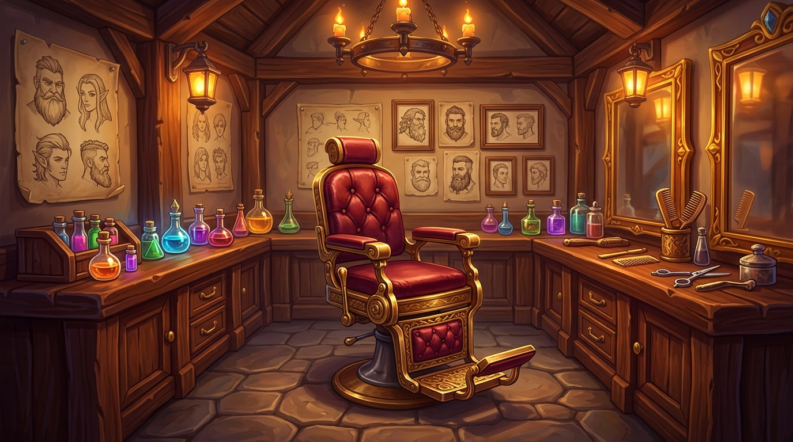

# mod-twow-barbershop: Native Turtle WoW Barbershop Module

A high-performance server-side module for Turtle WoW (1.18.1 / 1.12.1 vMaNGOS) that powers the client's built-in Barbershop interface without requiring any client addons.



---

## Features

- **Native Client Compatibility**: Fully implements the server-side `TW_BARBERSHOP` protocol used by the built-in Barbershop interface (`Turtle_BarbershopUI`). No client addons or MPQ modifications required.
- **Hair and Facial Customization**:
  - Hair style selection with complete race and gender bounds.
  - Hair color selection.
  - Facial hair, piercings, markings, horns, tusks, and features.
  - Supports all custom hairstyle additions in Turtle WoW across all 10 playable races, including Goblins and High Elves.
- **Private Single-Viewer Previews**:
  - Appearance previews are sent exclusively to the seated player's session using targeted values update packets.
  - Prevents network bandwidth overhead and prevents uncommitted preview changes from broadcasting to surrounding players.
  - Changes automatically revert if the player cancels, stands up, dies, moves away, or disconnects.
- **Dynamic Pricing Engine**:
  - Calculates customization costs dynamically using the standard level-squared formula: `(Level ^ 2) * BaseCost * (Modifier / 100)`.
  - Fully configurable cost percentages for hair style, hair color, and facial hair.
- **Decoupled Architecture**:
  - Zero edits to core engine files.
  - Bypasses core guild packet drops for guildless players by inspecting addon messages during packet receive hooks.
  - Directly updates standard character appearance fields (`playerBytes` and `playerBytes2`) without custom tables.

---

## Requirements

- Turtle WoW custom vMaNGOS core (`tortoise-wow` targeting client 1.18.1.7272).
- MariaDB / MySQL.

---

## Installation

These steps assume you have a working [TortoiseWoW](https://github.com/Penqle/tortoise-wow) source checkout, initialized core databases, and the server data files for your realm. Use a core revision compatible with this module. Run all build and SQL commands from the core source root, the directory containing the core's `CMakeLists.txt`.


### 1. Add the module and build on Linux

Use Git, CMake, a C++17 compiler, and the core's build dependencies. On Debian or Ubuntu, a typical starting point is:

```bash
sudo apt update
sudo apt install git cmake build-essential libace-dev default-libmysqlclient-dev libssl-dev zlib1g-dev
```

Use your distribution's `mysql` or `mariadb` command-line client if importing SQL manually. Keep any additional dependency and CMake settings required by your core and other enabled modules.

```bash
cd /path/to/tortoise-wow
git clone https://github.com/Ildourol/mod-twow-barbershop.git modules/mod-twow-barbershop
cmake -S . -B build -DCMAKE_BUILD_TYPE=Release -DCMAKE_INSTALL_PREFIX="$PWD/server-stage" -DMODULE_MOD_TWOW_BARBERSHOP=static
cmake --build build --parallel
cmake --install build
```

### 2. Add the module and build on Windows

Install Git for Windows, CMake 3.21 or later, and Visual Studio 2022 or its Build Tools with **Desktop development with C++** and a Windows SDK. Open PowerShell with Git and CMake on `PATH`. Use an x64 build and the dependency setup of your working core.

```powershell
Set-Location 'C:\src\tortoise-wow'
git clone https://github.com/Ildourol/mod-twow-barbershop.git modules/mod-twow-barbershop
cmake -S . -B build-vs -G "Visual Studio 17 2022" -A x64 "-DCMAKE_INSTALL_PREFIX=$PWD/server-stage" -DMODULE_MOD_TWOW_BARBERSHOP=static
cmake --build build-vs --config Release --parallel
cmake --install build-vs --config Release
```

Check each command for errors before continuing. Both builds include `mangosd`. If the configure output reports an unused module switch, verify the source placement before building. The two build sections are platform alternatives. If you already have a module checkout, use it in place of the clone. A full directory copy, a Linux symlink, or a Windows directory junction works as long as `modules/mod-twow-barbershop/src/` is directly below the module directory. The module directory name determines the CMake switch and loader symbol. If reusing a build directory, keep its generator and architecture and preserve the switches for your other modules. Reconfigure after adding the module and verify CMake lists it as static.

The staged world server is normally `server-stage/bin/mangosd` on Linux and `server-stage/mangosd.exe` on Windows. Stop the running world server before deploying the rebuilt executable and any required runtime libraries or module assets. Preserve the live configuration and data files. The paths below assume the standard staged layout. For an existing deployment, use the directory containing the active `mangosd.conf`, including a custom path passed via `-c`.

### 3. Set up the database

Back up the affected databases. The examples use `tw_char` and `tw_world` as database names. Substitute the names from the active `CharacterDatabase.Info` and `WorldDatabase.Info` settings as applicable, plus your database user and any connection options.

For a fresh install, apply the world script manually. The shipped character script `data/sql/character/001_barbershop_character.sql` drops the obsolete `character_barbershop_look` table. It is legacy cleanup and is unnecessary for a fresh installation. Exclude this module from automatic updates unless you intend to run that cleanup.

**Manual import on Linux (Bash)**

```bash
mysql -u root -p tw_world < "modules/mod-twow-barbershop/data/sql/world/001_barbershop_chair.sql"
```

**Manual import on Windows (PowerShell)**

Run `Get-Command mysql.exe` first. If it is unavailable, install the MySQL or MariaDB command-line client and add its `bin` directory to the current PowerShell session. Replace the example path below with your installation path. Use `mariadb.exe` in the import commands if that is the client you installed. Run imports in the order shown and stop if any command reports an error. `cmd.exe` handles input redirection so the SQL file reaches the client directly.

```powershell
# Only needed when mysql.exe is installed but missing from PATH
# $env:Path = 'C:\Program Files\MySQL\MySQL Server 8.0\bin;' + $env:Path
cmd.exe /d /c 'mysql.exe -u root -p tw_world < modules\mod-twow-barbershop\data\sql\world\001_barbershop_chair.sql'
if ($LASTEXITCODE -ne 0) { throw "Module SQL import failed" }
```

### 4. Deploy and enable the configuration

Create `mod-twow-barbershop.conf` inside the `modules/` subdirectory beside the active `mangosd.conf`. For a first install using the example staging directory, the following commands copy the shipped template. If an active module config already exists, retain it and merge new settings from the template.

**Linux**

```bash
mkdir -p server-stage/etc/modules
cp -n "modules/mod-twow-barbershop/conf/mod-twow-barbershop.conf.dist" "server-stage/etc/modules/mod-twow-barbershop.conf"
```

**Windows (PowerShell)**

```powershell
New-Item -ItemType Directory -Force 'server-stage/modules' | Out-Null
if (-not (Test-Path 'server-stage/modules/mod-twow-barbershop.conf')) {
    Copy-Item 'modules/mod-twow-barbershop/conf/mod-twow-barbershop.conf.dist' 'server-stage/modules/mod-twow-barbershop.conf'
}
```

Keep the template's section header and confirm `Barbershop.Enable = 1` in the active file. Start the rebuilt server with your normal launcher and active `mangosd.conf`. Check the startup log for module configuration, database, and dependency errors.

### Verify the installation

Interact with a barber chair using a test character. If the menu does not open, verify that world template `105180` exists and its script is `go_barber_chair`.

## Configuration Reference

Configuration options live in `mod-twow-barbershop.conf` under the `[Barbershop]` section:

| Option | Type | Default | Description |
|---|---|---|---|
| `Barbershop.Enable` | boolean | `1` | Master toggle to enable or disable the barbershop system. |
| `Barbershop.ChairEntries` | string | `"105180"` | Space or comma-separated list of GameObject template entries acting as barber chairs. |
| `Barbershop.Cost.Base` | integer | `5` | Base multiplier in copper for level-squared cost calculations. |
| `Barbershop.Cost.Style` | integer | `100` | Percentage of base cost applied when changing hair style. |
| `Barbershop.Cost.Color` | integer | `50` | Percentage of base cost applied when changing hair color without changing style. |
| `Barbershop.Cost.FacialHair` | integer | `75` | Percentage of base cost applied when changing facial hair or features. |
| `Barbershop.MaxChairDistance` | float | `5.0` | Maximum distance in yards from the chair before an active session automatically closes. |

---

## In-Game Usage

1. Locate any Barbershop Chair (GameObject entry `105180`), found in salons in major cities such as Stormwind and Orgrimmar.
2. Right-click the chair to sit down.
3. The native Barbershop window will open automatically.
4. Use the arrow selectors to preview hair styles, hair colors, and facial features.
5. Click **Accept** to finalize and purchase your new look, or click **Cancel** or stand up to revert to your original appearance.
